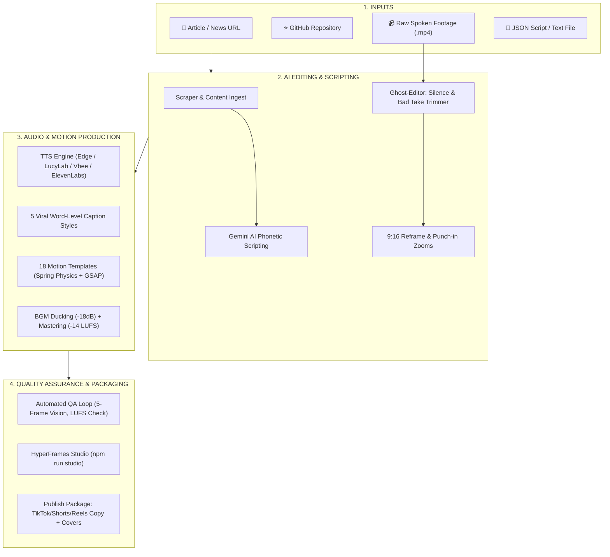

<a id="top"></a>

<div align="center">

# 🎬 Auto Video Gen 2.5 Pro Studio

### 🚀 Complete AI Video Studio: Turn Articles, GitHub Repos & Raw Spoken Footage into Viral Short-Form Videos

**One command · 18 Motion Templates · Word-level Karaoke Captions · AI Ghost Editor · -14 LUFS Mastering & BGM Ducking · Multi-ratio (9:16, 16:9, 1:1, 4:5)**

[](LICENSE)
[](https://nodejs.org)
[](https://www.typescriptlang.org/)
[](https://vitest.dev/)

[**🇻🇳 Tiếng Việt**](README.md) · [**🇬🇧 English**](README.en.md) · [**📖 Full Docs**](README.full.md) · [**🚀 Quick Start**](#-quick-start)

</div>

---

## 🌟 STUDIO PIPELINE ARCHITECTURE



---

## ✨ KEY FEATURES IN v2.5 PRO STUDIO

1. **🎨 18 Motion Design Templates:**
   - Powered by Spring Physics (`back.out(1.7)`) and Custom Bezier curves.
   - 3-attribute entrance choreography (`opacity` + `translate` + `scale/blur`).
   - Dynamic Mesh Gradient backgrounds with film grain and vignette overlays.
   - 6 Visual Styles (`--style`): `news`, `tech`, `minimal`, `high-energy`, `luxury`, `retro`.
   - Brand Kit support via `brand.config.json`.

2. **💬 Word-Level Viral Captions:**
   - 5 Styles: `karaoke-highlight`, `pop-in`, `box-highlight`, `hand-drawn-underline`, `minimal`.
   - Smart keyword highlighting with neon glows.
   - Guaranteed Vietnamese Safe Zones for TikTok/Shorts/Reels.
   - Exports `.srt` and `.vtt` formats.

3. **🤖 AI Ghost Editor (`/edit-raw-video`):**
   - Ingests raw spoken footage with multiple retakes and pauses.
   - Automatic silence detection via FFmpeg `silencedetect`.
   - Groups multi-takes of the same sentence, scores fluency, and keeps only the best take.
   - Auto-reframes to 9:16 with dynamic punch-in zooms (1.0x -> 1.18x -> 1.25x).
   - Side-by-side comparison video export (Raw vs Ghost-Edited).

4. **🔊 Broadcast Sound Design & Mastering:**
   - Sidechain BGM ducking (-18dB when speech is active).
   - Integrated loudness mastered to **-14.0 LUFS, True Peak ≤ -1.0 dBTP** (EBU R128).
   - Frame-accurate semantic SFX mapping.

5. **🔍 Automated QA Engine & Environment Doctor:**
   - `npm run qa:video`: Measures LUFS compliance and extracts 5 inspection keyframes.
   - `npm run doctor`: Environment diagnosis for Node 20+, FFmpeg filters, and API keys.

6. **🎛️ Studio Preview, Scene Rerendering & Multi-Ratio:**
   - Interactive timeline editor via `npm run studio`.
   - Target single scene re-render (`--scene <id>`) with SHA256 caching.
   - Multi-ratio layout support: `9:16`, `16:9`, `1:1`, `4:5`.
   - Batch URL runner (`npm run batch -- urls.txt`).

---

## 🚀 QUICK START

### 1. Requirements
- Node.js v20+ or v22+
- FFmpeg installed in system PATH (`ffmpeg -version`)

### 2. Setup
```bash
git clone https://github.com/hien23ns/autogen-video.git
cd autogen-video
npm install
npm run doctor # Run system diagnostics
```

### 3. Usage Examples
```bash
# Generate video from news URL:
npm run pipeline -- --url https://vnexpress.net/... --theme dark

# Generate video from GitHub repository:
npm run pipeline -- --url https://github.com/facebook/react --theme cyberpunk

# AI Ghost Editor (cut silence & bad takes from raw footage):
npm run edit-raw -- raw-take.mp4 --reframe 9:16 --compare

# Open Visual Studio:
npm run studio

# Verify video quality and LUFS compliance:
npm run qa:video -- output/my-video/video.mp4
```

---

## 🤖 AGENT SKILLS & SLASH COMMANDS

Synchronized across Antigravity (`.agents/skills/`) and Claude Code (`.claude/skills/`):

| Slash Command | Skill Name | Description |
| :--- | :--- | :--- |
| `/create-news-video` | `create-news-video` | Generate 9:16 short video from URL or text |
| `/edit-raw-video` | `edit-raw-video` | AI Ghost Editor for raw footage |
| `/repo-to-video` | `github-repo-to-video` | GitHub repository explainer video |
| `/video-qa` | `video-qa` | Automated quality & LUFS compliance check |
| `/make-captions` | `captions` | 5 viral word-level caption styles |
| `/sound-design` | `sound-design` | SFX mapping, ducking, and -14 LUFS mastering |
| `/publish-pack` | `publish-pack` | Multi-platform copy, checklists & thumbnails |

Sync skills at any time:
```bash
npm run skills:sync
```

---

## 📄 LICENSE
MIT License. All SFX and BGM assets comply with commercial licensing recorded in [assets/LICENSES.md](assets/LICENSES.md).
