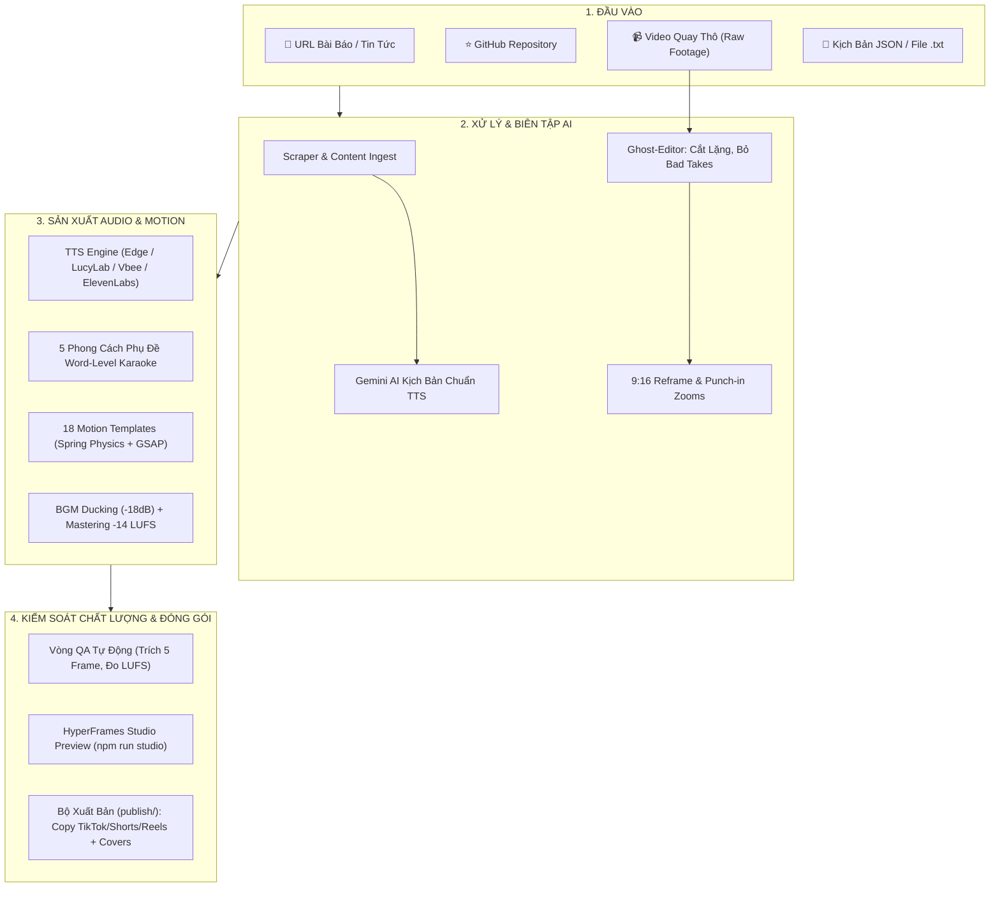

<a id="top"></a>

<div align="center">

# 🎬 Auto Video Gen 2.5 Pro Studio

### 🚀 Studio AI Hoàn Chỉnh Biến URL Bài Báo, GitHub Repo & Video Quay Thô Thành Video Triệu View

**1 câu lệnh · 18 Motion Templates · Phụ đề từng từ Karaoke · AI Ghost Editor · Âm thanh -14 LUFS Ducking · Đa tỉ lệ (9:16, 16:9, 1:1, 4:5)**

[](LICENSE)
[](https://nodejs.org)
[](https://www.typescriptlang.org/)
[](https://vitest.dev/)

</div>

---

## 🌟 TỔNG QUAN KIẾN TRÚC STUDIO (PIPELINE ARCHITECTURE)



---

## ✨ TÍNH NĂNG ĐỘT PHÁ Ở PHIÊN BẢN 2.5 PRO STUDIO

### 1. 🎨 Hệ Thống Motion Design Đỉnh Cao (18 Templates)
- **Spring Physics & Bezier Easing:** Chuyển động cơ học nảy mượt mà (`back.out(1.7)`), loại bỏ hoàn toàn các chuyển động phẳng.
- **Quy tắc 3 thuộc tính:** Mọi phần tử vào cảnh đều phối hợp `opacity` + `translate` + `scale/blur`.
- **Dynamic Mesh Gradient + Grain Overlay:** Nền sống động, chiều sâu điện ảnh, không còn nền màu phẳng nhàm chán.
- **18 Templates đa năng:**
  - *Tin tức & Số liệu:* `hook`, `stat-hero`, `comparison`, `feature-list`, `callout`, `outro`
  - *Hướng dẫn & So sánh:* `tutorial-steps`, `before-after` (slider tương tác), `product-showcase`, `timeline`
  - *Tech & Lập trình:* `github-repo-explainer`, `code-walkthrough` (gõ code & highlight dòng), `data-dashboard`
  - *Tương tác & Mạng xã hội:* `top-list-ranking`, `chat-conversation`, `map-route`, `testimonial-reaction`, `cta-outro`
- **6 Visual Styles (`--style`):** `news`, `tech`, `minimal`, `high-energy`, `luxury`, `retro`.
- **Brand Kit:** Đọc màu sắc, font chữ và logo trực tiếp từ `brand.config.json`.

### 2. 💬 Phụ Đề Từng Từ (Word-Level Viral Captions)
- **5 Phong cách phụ đề hot trend:** `karaoke-highlight`, `pop-in`, `box-highlight`, `hand-drawn-underline`, `minimal`.
- **Nhấn từ khóa tự động:** Tự động phát hiện số liệu, tên riêng công nghệ, từ cảm xúc để tăng cỡ chữ và đổi màu neon rực rỡ.
- **Ngắt dòng thông minh tiếng Việt:** 2–5 từ mỗi nhịp, đặt chính xác trong Safe Zone TikTok/Shorts (không bị che bởi nút Like/Share).
- **Xuất phụ đề đa năng:** Nhúng trực tiếp vào video hoặc xuất file `.srt` và `.vtt` rời.

### 3. 🤖 AI Ghost Editor (`/edit-raw-video`)
- **Tự cắt khoảng lặng:** Nhận diện và cắt sạch mọi khoảng lặng chết > 0.35s bằng FFmpeg `silencedetect`.
- **Lọc từ đệm & tật nói:** Cắt bỏ "ừm", "ờ", "à", "thì", "là", "kiểu như" và các lần nói vấp lặp từ.
- **Chọn Take Tốt Nhất:** Khi người quay nói hỏng và lặp lại câu, AI chấm điểm độ lưu loát và **chỉ giữ lại bản quay tốt nhất**.
- **Reframe 9:16 & Punch-ins:** Tự động crop video ngang thành dọc 9:16 và đổi cỡ cảnh (wide 1.0x -> punch-in 1.18x -> close-up 1.25x) sau mỗi 2 câu.
- **Bản so sánh Split-Screen:** Xuất video so sánh 2 nửa màn hình (Gốc vs Đã AI edit) với nhãn trực quan.

### 4. 🔊 Sound Design & Mastering Chuẩn Phát Sóng
- **Tự Động Ducking (Sidechain Compression):** Nhạc nền tự hạ -18dB khi người nói bắt đầu và dâng lên mượt mà khi ngắt câu.
- **Mastering EBU R128:** Âm lượng đạt chuẩn quốc tế **-14.0 LUFS, True Peak ≤ -1.0 dBTP**, không bị xé tiếng hay rè loa điện thoại.
- **SFX Frame-Accurate:** Tự động chọn âm thanh phù hợp theo chuyển động (whoosh, hit, cash register, chime).

### 5. 🔍 Vòng QA Tự Động & Chẩn Đoán Môi Trường
- **QA Verification:** Trích xuất 5 frame kiểm tra tràn chữ, vi phạm safe-zone, chênh lệch âm lượng, xuất báo cáo `qa-report.md`.
- **Doctor Tool (`npm run doctor`):** Chẩn đoán Node 20+, FFmpeg filters, API keys và đưa ra hướng dẫn sửa lỗi tức thì.

### 6. 🎛️ Studio Preview, Rerender & Đa Tỉ Lệ
- **HyperFrames Studio:** Chạy `npm run studio` mở trình chỉnh timeline trực quan trên trình duyệt.
- **Rerender theo cảnh:** `npm run rerender -- <dir> --scene hook --preset draft` chỉ render cảnh cần sửa trong vài giây nhờ cache SHA256.
- **Đa tỉ lệ:** `--ratio 9:16 | 16:9 | 1:1 | 4:5` co giãn bố cục tự động.
- **Batch Processing:** `npm run batch -- urls.txt` tạo hàng loạt video có hàng đợi và retry tự động.

---

## 🚀 CÀI ĐẶT & CHẠY NHANH

### 1. Yêu Cầu Hệ Thống
- **Node.js**: v20+ hoặc v22+
- **FFmpeg**: Đã cài đặt và có trong PATH hệ thống (`ffmpeg -version`)

### 2. Cài Đặt
```bash
git clone https://github.com/hien23ns/autogen-video.git
cd autogen-video
npm install
npm run doctor # Kiểm tra môi trường hoàn chỉnh
```

### 3. Cấu Hình `.env` (Tùy Chọn)
Copy file mẫu:
```bash
cp .env.example .env.local
```
*Ghi chú: Nếu không có API Key, hệ thống vẫn chạy 100% miễn phí với Edge TTS và bộ phân tích offline!*

---

## 💻 HƯỚNG DẪN SỬ DỤNG CHI TIẾT

### 1. Tạo Video Từ Link Bài Báo / GitHub Repo
```bash
# Video tin tức cơ bản:
npm run pipeline -- --url https://vnexpress.net/... --theme dark

# Video giới thiệu repo GitHub phong cách công nghệ:
npm run pipeline -- --url https://github.com/facebook/react --theme cyberpunk

# Tạo video với tỉ lệ màn hình ngang 16:9 (YouTube):
npm run pipeline -- --url https://... --ratio 16:9
```

### 2. Cắt Video Quay Thật Bằng AI Ghost-Editor
```bash
# Cắt bỏ lỗi, chọn best take, reframe 9:16:
npm run edit-raw -- raw-take.mp4 --reframe 9:16

# Xuất thêm video so sánh split-screen (Gốc vs Edit):
npm run edit-raw -- raw-take.mp4 --compare

# Chế độ xem trước kế hoạch cắt (Dry-run không tốn thời gian render):
npm run edit-raw -- raw-take.mp4 --dry-run
```

### 3. Tái Render Nhanh & Mở Studio
```bash
# Mở HyperFrames Visual Studio chỉnh sửa timeline:
npm run studio

# Render lại chỉ 1 cảnh duy nhất:
npm run rerender -- output/my-video --scene hook --preset draft

# Kiểm tra chất lượng và đo độ lớn LUFS:
npm run qa:video -- output/my-video/video.mp4

# Tạo video hàng loạt từ danh sách URL:
npm run batch -- urls.txt --concurrency 2
```

---

## 🤖 TÍCH HỢP AGENT SKILLS & LỆNH SLASH

Hệ thống cung cấp **8 Agent Skills** tương thích 100% cho cả **Google Antigravity** (`.agents/skills/`) và **Claude Code** (`.claude/skills/`).

| Lệnh Slash | Skill | Chức Năng |
| :--- | :--- | :--- |
| `/create-news-video` | `create-news-video` | Tạo video 9:16 hoàn chỉnh từ bài báo / .txt |
| `/edit-raw-video` | `edit-raw-video` | AI Ghost Editor: cắt lỗi, chọn best take, reframe 9:16 |
| `/repo-to-video` | `github-repo-to-video` | Biến repo GitHub thành video giới thiệu công nghệ |
| `/video-qa` | `video-qa` | Chạy bộ phân tích chất lượng video và đo LUFS |
| `/make-captions` | `captions` | Tạo phụ đề karaoke 5 phong cách chuẩn viral |
| `/sound-design` | `sound-design` | Thiết kế SFX, ducking nhạc nền và mastering -14 LUFS |
| `/publish-pack` | `publish-pack` | Xuất copy đa nền tảng, checklist và cover thumbnail |
| `/motion-design` | `motion-design` | Quy tắc chuyển động cơ học spring, bezier và brand kit |

Đồng bộ skills 2 chiều bất kỳ lúc nào:
```bash
npm run skills:sync
```

---

## 💰 BẢNG CHI PHÍ VẬN HÀNH (0đ vs Có Key)

| Dịch vụ | Chế độ Miễn Phí (Default 0đ) | Chế độ Nâng Cao (Khi có API Key) |
| :--- | :--- | :--- |
| **TTS Giọng Đọc** | **Edge TTS** (Nam Minh, Hoài My - Miễn phí 100%) | LucyLab, Vbee, ElevenLabs (Giọng clone cao cấp) |
| **Biên Tập Kịch Bản** | Heuristic Parser / Scraper nội bộ | Google Gemini (`gemini-3.5-flash` - Miễn phí hạn mức lớn) |
| **Whisper Transcribe** | Heuristic silence & pause alignment | OpenAI Whisper API (`whisper-1` timestamp từng từ) |
| **SFX & BGM** | Thư viện âm thanh thương mại miễn phí bản quyền kèm sẵn | Bổ sung thêm SFX tùy ý vào `assets/sfx` |
| **Render Engine** | HyperFrames cục bộ 100% offline | Render đám mây qua GitHub Actions Webhook |

---

## ❓ FAQ & XỬ LÝ SỰ CỐ (TROUBLESHOOTING)

#### 1. Lệnh `ffmpeg` báo không tìm thấy?
- Chạy `npm run doctor` để kiểm tra.
- Trên Windows, cài đặt nhanh bằng lệnh: `winget install Gyan.FFmpeg`.

#### 2. Phụ đề tiếng Việt có bị vỡ font không?
- Hoàn toàn không! Mọi template sử dụng font Google Fonts hỗ trợ đầy đủ bộ gõ tiếng Việt có dấu: `Be Vietnam Pro`, `Montserrat`, `Inter`, `Anton`.

#### 3. Làm thế nào để đổi màu thương hiệu (Brand Kit)?
- Chỉnh sửa file `brand.config.json` ở thư mục gốc: thay đổi logo, mã màu primary/accent và font chữ.

---

## 📄 GIẤY PHÉP (LICENSE)
Dự án phát hành theo giấy phép [MIT License](LICENSE).  
Mọi tài nguyên âm thanh (SFX, BGM) tuân thủ danh mục bản quyền tại [assets/LICENSES.md](assets/LICENSES.md).
